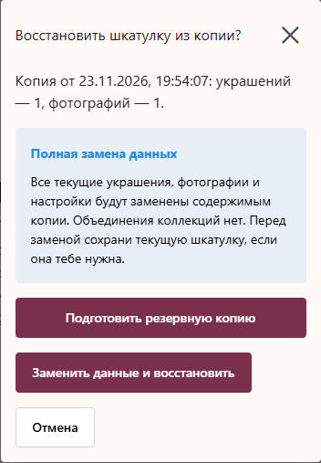
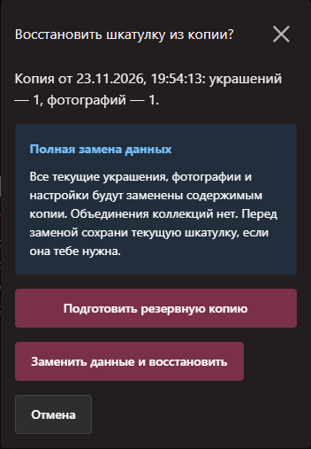

# Jewellery Box

Личная шкатулка: каталог украшений с оригиналами фотографий, динамическими полями, фильтрами и аналитикой. React, TypeScript strict, Mantine, CSS Modules, Dexie/IndexedDB. Без backend, телеметрии и внешней загрузки фотографий.

## Запуск

Node.js `^20.19.0` или `>=22.12.0`.

```sh
npm ci
npm run dev
npm run build
npm run preview
```

Маршруты: `#/collection`, `#/settings`, `#/analytics`. Для публикации нужен постоянный HTTPS-адрес; локальный preview служит для проверок production-сборки. Публикация в рамках задачи 04 не выполняется.

## Архитектура

- `entities`: доменные правила, схемы и runtime-валидация.
- `data`: IndexedDB, миграции, транзакции и подписки.
- `features`: формы, фотографии, фильтры и перенос коллекции.
- `widgets`, `pages`, `app`: композиция экранов и навигация.

Карточка хранит независимый снимок полей и справочных подписей. Изменение шаблона влияет на новые формы. Фото хранятся отдельно как оригинальные Blob, загружаются по видимости; object URL освобождаются. Оформление хранится в IndexedDB, localStorage — производный кэш.

## Копия и восстановление

В настройках доступен перенос всей коллекции ZIP-файлом: карточки, снимки, оригиналы фото, шаблон, справочники, оформление и цены металлов. Восстановление полностью заменяет текущую коллекцию после проверки и явного подтверждения; объединения нет. Перед заменой сохрани текущую копию. Неизвестные версии и повреждённые копии отклоняются до записи. Архив содержит личные данные и не шифруется.

ZIP с фото одной карточки и резервная копия коллекции — разные форматы. Для восстановления нужен файл из раздела переноса коллекции.

## Офлайн и обновления

После подготовки офлайн-кэша основные экраны доступны без сети. Обновление предлагается отдельно; заполненные формы не должны перезагружаться автоматически. Добавление значка на экран телефона и сохранение резервной копии — разные действия. Браузерное хранилище не заменяет копию на другом носителе.

## Проверки

```sh
npm run build
npm run lint
npm test
npm run format:check
npm run test:browser
```

Браузерные тесты используют установленный Chrome и production preview на порту 4173. Тестовые карточки и фото синтетические. Результаты и ограничения приёмки: [задача 04](docs/specs/001-jewellery-catalog/tasks/04-pwa-backup/task.md).

## Ограничения

Физические iPhone/Android, HEIC/EXIF, большой архив с реальными фото и пиковая память требуют отдельной проверки. Автоматизация Chrome не доказывает совместимость Safari/PWA на iPhone. Синтетический тест 100 карточек проверяет ленивое чтение фото, а не память декодирования реальных снимков. Минимальные targets сборки — Chrome 111, Firefox 113, Safari 16.2; это не подтверждённая матрица устройств.

## Документы

[Спецификация](docs/specs/001-jewellery-catalog/spec.md) · [План](docs/specs/001-jewellery-catalog/plan.md) · [Модель данных](docs/specs/001-jewellery-catalog/data-model.md) · [Задачи](docs/specs/001-jewellery-catalog/tasks.md)

## Скриншоты с вымышленными данными




